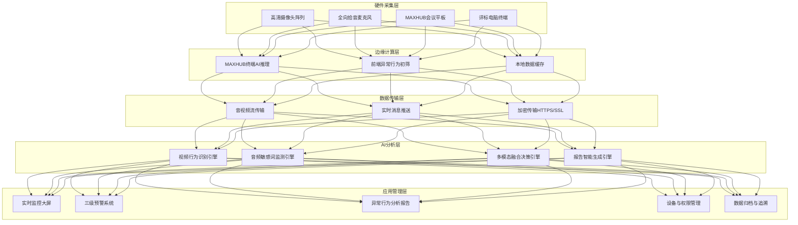

# Bid Evaluation Behavior Recognition System

> 多模态AI远程异地评标专家异常行为识别系统 — 技术方案与架构设计

**技术栈：** Multi-Modal Fusion · CV目标检测 · 时序行为识别 · 语音转文字(ASR) · 敏感词实时监测 · 三级预警机制 · 边缘AI部署 · YOLOv8 · PyTorch · Whisper · 国产算力适配

---

## 🎬 项目介绍视频

<div align="center">


**多模态AI远程异地评标专家异常行为识别系统 — 项目介绍（前30秒精华）**

📥 [点击下载完整视频（1分48秒，含音频）](assets/videos/project-intro.mp4)

</div>

---

## 项目定位

**多模态AI远程异地评标专家异常行为识别系统**是由**广州市政府采购中心**联合**视源股份（MAXHUB）**通过**合作创新采购方式**（财库〔2024〕13号）共同研发的智慧监管系统，于2026年启动研发，是全国首个面向政府采购远程异地评标场景的多模态AI异常行为识别系统。

系统以"AI+政府采购评审监管"为核心技术路径，通过**视频行为识别+音频敏感词监测+系统操作日志**三路数据融合，实时检测评标专家在远程异地评审过程中的异常行为（操作手机、交头接耳、起身离席、不当言论等），并通过**黄/橙/红三级预警机制**实时干预，评审结束后自动生成**疑似异常行为分析报告**，实现"事前防范、事中预警、事后追溯"全流程智慧监管。

系统深度适配政府采购强监管、高合规要求的行业特性，依托**视源股份MAXHUB会议平板**硬件生态，支持隔断型评标工位和专用型评标场所双场景部署，计划联合推广至全国各地公共资源交易中心及社会代理机构，作为远程异地评标节点的智慧监管基础设施。

---

## 核心亮点

### 亮点一：合作创新采购模式，政企联合研发

本项目采用财政部《政府采购合作创新采购管理暂行办法》（财库〔2024〕13号）规定的**合作创新采购方式**，由广州市政府采购中心作为采购人提出需求，视源股份（MAXHUB）作为研发供应商联合研发：

- **风险共担**：研发成本补偿（3万元）+ 首购费用（42.586万元）+ 激励费用，分阶段支付
- **成果共享**：知识产权双方共同拥有，采购人享有永久免费使用权及推广权
- **联合推广**：计划联合推广至全国各地公共资源交易中心及社会代理机构
- **两阶段评审**：第一阶段研发方案（60分）选前3名，第二阶段其他（40分）定成交

### 亮点二：视频+音频+日志三路多模态融合

系统突破传统单一视频监控的局限，构建**三路数据融合**的多模态异常行为识别架构：

| 数据通道 | 检测内容 | 技术方案 |
|---------|---------|---------|
| **视频通道** | 操作手机、起身离席、交头接耳、肢体频繁遮挡面部 | YOLOv8目标检测 + SlowFast时序行为识别 + 人脸关键点检测 |
| **音频通道** | 敏感词/违规言论、私下交谈、环境音异常 | Whisper语音转文字 + 四大类违禁词库实时匹配 + 声纹分离 |
| **系统日志** | 操作异常、网络卡顿、登录异常、权限越界 | 操作日志实时采集 + 规则引擎异常检测 |

三路数据通过**时间戳对齐+置信度加权融合**，综合判定异常行为等级，大幅降低单一通道的误报率和漏报率。

### 亮点三：四大类违禁词库 + 三级预警机制

系统构建了政府采购评审场景专用的**四大类违禁词库**，并设计了**黄/橙/红三级递进式预警机制**：

**四大类违禁词库：**
1. **核心违禁词与高风险表述**：放水、松点、严点、抬分、压分、加分、减分、凑分、改分、抹掉、忽略、跳过、不用看
2. **敏感信息泄露类**：内定、指定、推荐、选这家、要这个、定这个、倾向、偏爱、看好、中意、首选、必选、淘汰XX、留下XX、放弃XX
3. **倾向性言论类**：不行、不好、差、烂、垃圾、不行就换、这家不行、那家好、这家靠谱、那家不靠谱、肯定行、绝对不行、没问题、有问题
4. **非正常评价类**：主观臆断、不按评审标准评审、凭经验选、随便打分等

**三级预警机制：**
| 预警等级 | 触发条件 | 音频提示 | 视频提示 |
|---------|---------|---------|---------|
| 🟡 **黄色预警** | 首次轻微疑似违规，首次识别到违规词汇/表述 | "请注意评标纪律，请使用中性表述。" | 屏幕侧边浮现【合规提示】浮窗，持续5秒 |
| 🟠 **橙色警示** | 重复或明显疑似违规，多次识别到同一类违规行为 | "系统多次检测到异常表述，请立即停止违规评审言行。" | 中央弹窗显示【警告！】+违规片段回放 |
| 🔴 **红色警报** | 重大疑似违规（如改分、内定等） | "因涉嫌违规，建议立即暂停评审活动。" | 全屏红色显示【警告！涉嫌违规】+同步生成证据包 |

### 亮点四：自动生成疑似异常行为分析报告

评审结束后，系统基于全程音视频监控数据和系统操作日志，**自动生成结构化的疑似异常行为分析报告**，包含：

1. **项目基本信息**：项目编号、名称、评审委员会组成、评审地点、时间范围、总时长
2. **疑似异常行为分析**：按异常类型（操作手机/交头接耳/起身离席/不当言论/其他）分类，记录发生时间段、涉及专家、场景描述、系统监测依据
3. **活跃视频时段记录**：专家正常沟通、发言、讨论的有效工作时段，按时间顺序排列
4. **综合结论**：异常行为统计（轻微异常X项/建议人工复核X项），处理建议

报告自动存档于"远程评审监控系统"数据库，原始记录可追溯查询，为监管部门提供客观、精准的评审监管支撑。

### 亮点五：MAXHUB硬件生态 + 边缘AI私有化部署

系统深度适配**视源股份MAXHUB会议平板**硬件生态，采用**边缘计算+集中运算融合**架构：

- **前端边缘节点**：MAXHUB智能终端集成AI推理能力，本地实时识别简单异常行为（操作手机、离席），降低传输延迟和带宽压力
- **后端集中运算**：服务器/云端处理复杂多模态融合分析、敏感词语义理解、报告生成
- **私有化部署**：支持本地化部署，音视频数据不出内网，满足政府采购数据安全和等保二级要求
- **国产适配**：兼容鸿蒙/麒麟等自主操作系统，关键设备优先采用国产化硬件

### 亮点六：双场景适配 + 多并发支持

系统支持政府采购评审的两大核心场景：

| 场景 | 部署方式 | 核心功能 |
|------|---------|---------|
| **隔断型评标工位** | 评标电脑内置远程评标软件 + 高清摄像头 + 全向麦克风 | 专家一键入会、实时音视频交互、评标辅流资料同步推送、独立评标行为监控 |
| **专用型评标场所** | MAXHUB远程异地评标智能终端 + 多摄像头阵列 | 多专家本地投屏、双向音视频互通、标书协同批注与共享、集体讨论行为监控 |

系统支持**多并发远程异地评标业务**，各评标场景画面和声音互相不影响，理论上并发数量无上限（受平台性能限制），支持≥10组同步评审。

---

## 系统架构

系统采用**五层架构设计**，自下而上分为硬件采集层、边缘计算层、数据传输层、AI分析层、应用管理层：



详见：[docs/system-architecture.md](docs/system-architecture.md)

---

## 核心技术方案

### 1. 视频行为识别：目标检测+时序行为识别双路架构

视频通道采用**YOLOv8目标检测+SlowFast时序行为识别**双路架构：

- **目标检测路**：YOLOv8实时检测人体、手机、人脸等目标，输出位置、置信度、跟踪ID
- **时序行为识别路**：SlowFast网络提取时空特征，识别操作手机、起身离席、交头接耳等连续动作
- **人脸关键点检测**：MediaPipe提取68个人脸关键点，检测低头、遮挡面部、视线异常等微行为
- **多目标跟踪**：DeepSORT跟踪算法，跨帧关联同一专家，统计行为持续时间和频次

**检测的异常行为类型：**

| 异常类型 | 检测方法 | 判定阈值 |
|---------|---------|---------|
| 操作手机 | YOLOv8手机检测 + 手部关键点 + 低头姿态 | 手机出现+手部交互+持续≥3秒 |
| 起身离席 | 人体检测 + 座位区域判定 + 持续时间 | 人体离开座位区域≥30秒 |
| 交头接耳 | 多人距离检测 + 朝向判定 + 音频能量 | 两人距离<0.5m+朝向对方+未开麦+持续≥5秒 |
| 肢体遮挡面部 | 人脸关键点 + 手部位置 | 手部遮挡面部≥5秒（非喝水等正常动作） |
| 长时间静止/走神 | 姿态估计 + 头部运动 | 头部静止+视线偏离屏幕≥60秒 |

详见：[docs/multimodal-fusion.md](docs/multimodal-fusion.md) | 代码：[code-snippets/behavior_detection.py](code-snippets/behavior_detection.py)

### 2. 音频敏感词监测：ASR转写+四大类违禁词库实时匹配

音频通道采用**Whisper语音转文字+四大类违禁词库实时匹配+声纹分离**方案：

- **语音转文字（ASR）**：Whisper-large-v3中文模型，实时转写评审对话，延迟<1秒，准确率≥95%
- **违禁词库匹配**：AC自动机多模式匹配，实时检测四大类违禁词和高风险表述，支持单字/短语/完整句式三级匹配
- **声纹分离**：基于说话人分离技术，区分不同专家的发言，精准定位违规言论的发言人
- **语义理解**：大语言模型辅助理解上下文，区分正常讨论和违规言论，降低误报率

**四大类违禁词库详情：** 详见[docs/sensitive-word-library.md](docs/sensitive-word-library.md)

详见：[docs/sensitive-word-library.md](docs/sensitive-word-library.md) | 代码：[code-snippets/sensitive_word_monitor.py](code-snippets/sensitive_word_monitor.py)

### 3. 多模态融合决策：时间戳对齐+置信度加权

三路数据（视频/音频/日志）通过**时间戳对齐+置信度加权融合**，综合判定异常行为：

```
融合决策公式：
final_score = w_video × video_score + w_audio × audio_score + w_log × log_score

其中权重根据异常类型动态调整：
- 操作手机：w_video=0.7, w_audio=0.1, w_log=0.2
- 不当言论：w_video=0.1, w_audio=0.8, w_log=0.1
- 交头接耳：w_video=0.5, w_audio=0.4, w_log=0.1
```

融合决策输出：异常类型、置信度、发生时间段、涉及专家、证据片段（视频截图+音频转写+日志记录）、预警等级。

详见：[docs/multimodal-fusion.md](docs/multimodal-fusion.md) | 代码：[code-snippets/multimodal_fusion.py](code-snippets/multimodal_fusion.py)

### 4. 三级预警与Agent工作流

系统设计了**黄/橙/红三级递进式预警机制**，并通过Agent工作流实现预警的自动化处置：

- **黄色预警**：首次轻微违规 → 音频提示+侧边浮窗 → 记录但不中断评审
- **橙色警示**：重复/明显违规 → 音频警告+中央弹窗+片段回放 → 记录并提醒主持人
- **红色警报**：重大违规 → 全屏警告+建议暂停+证据包自动生成 → 通知监管部门

Agent工作流负责：异常检测→等级判定→预警触发→证据固化→记录归档→报告生成的全流程自动化。

详见：[docs/agent-workflow.md](docs/agent-workflow.md) | 代码：[code-snippets/agent_workflow.py](code-snippets/agent_workflow.py)

### 5. 异常行为分类体系

系统建立了完整的**评标专家异常行为分类体系**，涵盖5大类、15+小类异常行为：

| 大类 | 小类 | 检测通道 | 严重等级 |
|------|------|---------|---------|
| **操作手机** | 操作手机、查看手机、使用手机通讯 | 视频 | 中 |
| **交头接耳** | 私下交谈、未开麦交流、传递信息 | 视频+音频 | 中 |
| **起身离席** | 长时间离席、频繁离席、非正常时段离席 | 视频 | 低-中 |
| **不当言论** | 核心违禁词、敏感信息泄露、倾向性言论、非正常评价 | 音频 | 高 |
| **其他异常** | 网络异常、操作异常、登录异常、设备异常 | 日志 | 低 |

详见：[docs/abnormal-behavior-taxonomy.md](docs/abnormal-behavior-taxonomy.md)

### 6. 边缘AI私有化部署

系统采用**边缘计算+集中运算融合**的部署架构，满足政府采购数据安全和私有化部署要求：

- **前端边缘推理**：MAXHUB终端集成轻量化AI模型（YOLOv8n+Whisper-small），本地实时初筛，只传输异常片段和特征数据
- **后端集中分析**：服务器部署完整模型，进行多模态融合、语义理解、报告生成
- **数据安全**：音视频数据不出内网，加密存储，等保二级合规，关键视频帧量子密钥保护
- **三级存储**：热数据（最近7天）SSD高速存储 + 温数据（3个月）SAS存储 + 冷数据（长期归档）对象存储，符合《电子档案管理规范》GB/T 18894

详见：[docs/edge-deployment.md](docs/edge-deployment.md)

### 7. 算法研发与模型优化全流程

系统的核心算法经过了从研究到工程落地的完整优化链路，展示了从算法研究到边缘部署的全链路技术能力：

**YOLOv8目标检测模型优化五步法：**

| 优化步骤 | 技术方法 | mAP@0.5 | 推理延迟(CPU) | 模型体积 |
|---------|---------|---------|-------------|---------|
| 原始YOLOv8n | 基线模型 | 89.5% | 120ms | 12.8MB |
| ① 场景微调 | 两阶段微调（冻结backbone+全网络）+ 场景感知数据增强 | 92.8% | 120ms | 12.8MB |
| ② 知识蒸馏 | 教师YOLOv8m→学生YOLOv8n，KL散度软标签损失（T=4） | 92.8% | 120ms | 12.8MB |
| ③ 结构化剪枝 | BN层γ因子通道剪枝30% + 层剪枝10% + 微调恢复 | 92.3% | 85ms | 8.3MB |
| ④ INT8量化 | 量化感知训练(QAT) + 1000张校准集 + 对称量化 | 91.5% | 50ms | 2.1MB |
| ⑤ TensorRT编译 | 算子融合 + 内核自动调优 + FP16/INT8混合精度 | 91.5% | **8ms**(Jetson) | 2.1MB |

**最终边缘部署效果：** mAP=91.5%，延迟=8ms（Jetson Orin NX），FPS=125，模型体积2.1MB，完全满足≤200ms实时性要求。

**Whisper ASR领域自适应微调：**
- 两阶段微调：语言模型适配（360万字领域语料）+ 声学模型端到端微调（200小时评标场景音频）
- 热词增强：5000个政府采购专业术语Shallow Fusion
- 效果：整体CER 9.8%→6.5%，专业术语CER 18.5%→7.2%，数字识别准确率85.2%→94.8%

**多模态融合算法：**
- 置信度加权融合：final_score = Σ w_i × score_i，权重根据异常类型动态调整
- 可靠性动态计算：w_i = base_weight_i × reliability_i × relevance_i
- 交叉验证：强确认/弱确认/疑似/矛盾四级验证，矛盾则降级
- 贝叶斯后验融合（可选）：对数似然比形式，自然处理缺失通道

详见：[docs/algorithm-rd-optimization.md](docs/algorithm-rd-optimization.md) | 代码：[code-snippets/model_training.py](code-snippets/model_training.py)

---

## 异常行为分析报告

评审结束后，系统自动生成结构化的**疑似异常行为分析报告**，报告模板包含：

1. **项目基本信息**：项目编号、名称、评审委员会组成（业主代表+抽取专家）、评审地点、时间范围、总时长
2. **疑似异常行为分析**：按类型分类表格（异常类型/发生时间段/涉及专家/场景描述/系统监测依据）
3. **活跃视频时段记录**：有效工作时段（核对文件、讨论技术方案、发起澄清等）
4. **综合结论**：异常统计（轻微异常X项/建议人工复核X项），处理建议

报告自动存档，原始记录可追溯查询。

详见：[docs/analysis-report-template.md](docs/analysis-report-template.md)

---

## 技术性能指标

| 指标 | 目标值 | 说明 |
|------|--------|------|
| 异常行为识别准确率 | ≥95% | 多模态融合后综合准确率 |
| 视频行为检测延迟 | ≤200ms | 从行为发生到预警触发 |
| 音频转写延迟 | ≤1秒 | 实时语音转文字 |
| 音视频交互延迟 | ≤100ms | MAXHUB终端低延迟传输 |
| 违禁词检测准确率 | ≥98% | 四大类违禁词库匹配 |
| 误报率 | ≤5% | 多模态融合后误报率 |
| 并发评审支持 | ≥10组 | 同时进行的远程评标业务数 |
| 系统可用性 | ≥99.9% | 7×24小时稳定运行 |
| 等保级别 | 二级及以上 | 网络安全等级保护 |
| 数据存储周期 | ≥10年 | 符合电子档案管理规范 |

---

## 应用成效与价值

### 监管效率提升

- 异常行为发现效率提升**80%以上**（从人工逐帧回看到实时自动检测）
- 人工核查工作量减少**90%**（系统自动筛选异常片段，人工只需复核）
- 评审监管从"事后抽查"升级为"实时全覆盖"

### 合规风险防控

- 有效防范"人情标""串通评审"等违规行为
- 评审全程留痕、行为可溯、责任可究
- 为质疑投诉处理和行政处罚提供客观证据支撑

### 成本节约

- 减少人工监控人力投入
- 降低因违规导致的项目废标、重新采购成本
- 远程异地评标减少专家差旅成本

### 示范推广价值

- 全国首个政府采购远程异地评标多模态AI异常行为识别系统
- 合作创新采购模式的典型实践案例
- 计划联合视源股份推广至全国各地公共资源交易中心及社会代理机构
- 为行业标准制定提供实践基础

---

## 文档索引

| 文档 | 说明 |
|------|------|
| [docs/system-architecture.md](docs/system-architecture.md) | 五层系统架构详解 + 硬件方案 + 数据流设计 |
| [docs/multimodal-fusion.md](docs/multimodal-fusion.md) | 视频+音频+日志三路多模态融合方案 + 融合决策算法 |
| [docs/agent-workflow.md](docs/agent-workflow.md) | 三级预警Agent工作流 + 异常处置自动化流程 |
| [docs/edge-deployment.md](docs/edge-deployment.md) | 边缘AI私有化部署方案 + 数据安全 + 三级存储 |
| [docs/abnormal-behavior-taxonomy.md](docs/abnormal-behavior-taxonomy.md) | 异常行为分类体系（5大类15+小类）+ 检测方法 + 判定阈值 |
| [docs/sensitive-word-library.md](docs/sensitive-word-library.md) | 四大类违禁词库详解 + 三级预警机制 + 音视频提示内容 |
| [docs/analysis-report-template.md](docs/analysis-report-template.md) | 疑似异常行为分析报告模板 + 字段说明 + 生成流程 |
| [docs/cooperative-innovation-procurement.md](docs/cooperative-innovation-procurement.md) | 合作创新采购模式详解 + 风险共担成果共享 + 联合推广 |
| [docs/algorithm-rd-optimization.md](docs/algorithm-rd-optimization.md) | 🔬 算法研发与优化全流程 + 模型选型对比 + 数据工程 + 训练策略 + 蒸馏剪枝量化 + 性能基准 |

---

## 核心代码片段

> 以下代码为脱敏后的核心逻辑片段，展示技术方案的实现思路，非完整生产代码。

| 文件 | 说明 |
|------|------|
| [behavior_detection.py](code-snippets/behavior_detection.py) | 视频行为识别核心逻辑（YOLOv8检测+SlowFast时序识别+人脸关键点+多目标跟踪） |
| [sensitive_word_monitor.py](code-snippets/sensitive_word_monitor.py) | 音频敏感词监测核心逻辑（Whisper转写+AC自动机四大类违禁词匹配+三级预警触发） |
| [multimodal_fusion.py](code-snippets/multimodal_fusion.py) | 多模态融合决策核心逻辑（时间戳对齐+置信度加权+异常等级判定） |
| [agent_workflow.py](code-snippets/agent_workflow.py) | Agent工作流核心逻辑（异常检测→等级判定→预警触发→证据固化→报告生成） |
| [model_training.py](code-snippets/model_training.py) | 🔬 模型训练与优化全流程（YOLOv8微调+知识蒸馏+结构化剪枝+INT8量化+TensorRT编译+Whisper领域自适应微调） |

---

## 架构图

| 图表 | 说明 |
|------|------|
| [diagrams/system-architecture.mmd](diagrams/system-architecture.mmd) | 五层系统架构图 |
| [diagrams/multimodal-pipeline.mmd](diagrams/multimodal-pipeline.mmd) | 多模态融合处理流程图 |
| [diagrams/agent-loop.mmd](diagrams/agent-loop.mmd) | Agent工作流与三级预警循环图 |

---

## 关于本仓库

本仓库为项目技术方案与架构设计的公开文档，因政企项目数据安全与保密要求，不包含完整源码、训练数据和生产环境配置。核心代码片段已做脱敏处理，旨在展示架构设计能力与技术方案思路。

项目采用**合作创新采购方式**研发，知识产权由**广州市政府采购中心**与**视源股份（MAXHUB）**共同拥有，采购人享有永久免费使用权及推广权。

---

*Architecture design & technical documentation by Yuge Wu | 广州市政府采购中心 · 远程异地评审智慧解决方案合作创新采购项目*
