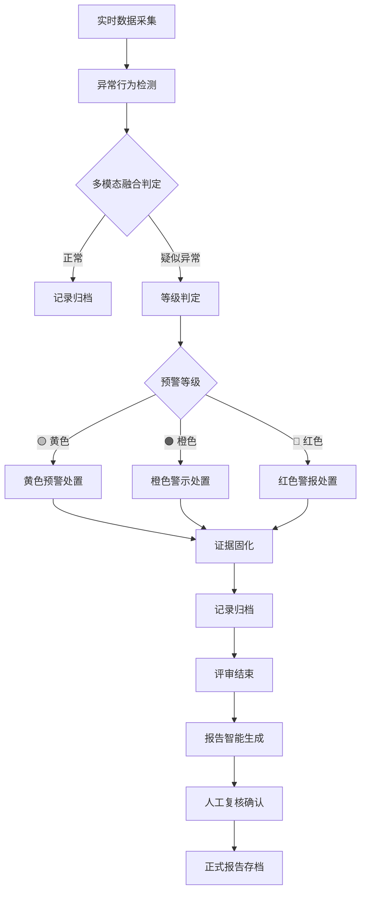

# Agent工作流与三级预警

> 本文档详细描述异常行为检测→等级判定→预警触发→证据固化→记录归档→报告生成的全流程Agent工作流，以及黄/橙/红三级预警的处置机制。

---

## 一、Agent工作流总览

系统通过Agent工作流实现异常行为检测和处置的全流程自动化：



---

## 二、实时数据采集

### 2.1 采集内容

| 数据类型 | 采集方式 | 采集频率 | 时间戳精度 |
|---------|---------|---------|-----------|
| 视频流 | 摄像头RTSP/USB采集 | 25-30fps | 毫秒级 |
| 音频流 | 麦克风阵列采集 | 16kHz采样 | 毫秒级 |
| 系统日志 | 日志接口实时推送 | 事件驱动 | 毫秒级 |
| 设备状态 | 设备管理接口轮询 | 1次/秒 | 秒级 |
| 网络状态 | 网络监控工具 | 1次/秒 | 秒级 |

### 2.2 数据预处理

- **视频**：解码→缩放→归一化→输入AI模型
- **音频**：降噪→回声消除→VAD检测→ASR转写
- **日志**：格式化→字段提取→规则匹配
- **时间同步**：NTP时钟同步，所有数据带统一时间戳

---

## 三、异常行为检测

### 3.1 三路并行检测

系统三路数据并行检测，互不阻塞：

**视频检测Agent：**
- YOLOv8目标检测（人体、手机、人脸、手部）
- SlowFast时序行为识别
- MediaPipe人脸关键点和姿态估计
- DeepSORT多目标跟踪
- 输出：视频异常事件列表

**音频检测Agent：**
- Whisper实时语音转文字
- AC自动机违禁词匹配
- 声纹分离（说话人识别）
- 大语言模型语义消歧
- 输出：音频异常事件列表

**日志检测Agent：**
- 系统日志实时采集
- 规则引擎异常模式匹配
- 网络状态异常检测
- 设备状态异常检测
- 输出：日志异常事件列表

### 3.2 检测频率

- 视频检测：实时（每帧或关键帧）
- 音频检测：实时（ASR输出后立即匹配）
- 日志检测：实时（事件触发）
- 融合决策：每500ms一次（滑动窗口）

---

## 四、多模态融合判定

### 4.1 融合流程

1. **时间戳对齐**：将三路异常事件按时间戳对齐到±2秒窗口
2. **事件关联**：同一时间窗口内、同一专家的异常事件进行关联
3. **置信度加权**：根据异常类型动态调整各通道权重，计算final_score
4. **交叉验证**：检查通道间是否矛盾，矛盾则降级处理
5. **等级判定**：根据final_score判定异常等级（疑似/确认/严重）

详见：[multimodal-fusion.md](multimodal-fusion.md)

### 4.2 融合决策输出

```
融合决策结果：
- event_id: 事件唯一ID
- event_type: 异常类型
- severity: 严重等级（低/中/高）
- confidence: 综合置信度（0-1）
- start_time/end_time: 发生时间段
- expert_id: 涉及专家
- channel_scores: 各通道得分
- evidence: 证据引用
- detection_basis: 检测依据
```

---

## 五、三级预警机制

### 5.1 预警等级定义

| 预警等级 | 触发条件 | 严重程度 | 处置方式 |
|---------|---------|---------|---------|
| 🟡 **黄色预警** | 首次轻微疑似违规，首次识别到违规词汇/表述 | 低 | 温和提示，记录但不中断评审 |
| 🟠 **橙色警示** | 重复或明显疑似违规，多次识别到同一类违规行为 | 中 | 明确警告，提醒主持人，记录证据 |
| 🔴 **红色警报** | 重大疑似违规（如改分、内定、泄露标底等） | 高 | 强烈警告，建议暂停评审，生成证据包 |

### 5.2 预警升级规则

- 同一专家同类违规累计≥2次：黄色→橙色
- 同一专家同类违规累计≥3次：橙色→红色
- 不同专家同时发表同类违规（疑似串通）：直接红色
- 高风险违禁词（改分、内定等）：首次即橙色或红色
- 预警间隔内（60秒）同类行为不重复预警

### 5.3 黄色预警处置

**触发条件：**
- 首次检测到低风险倾向性词汇（不行、不好、差等）
- 首次检测到中风险非正常评价词汇（凭经验、随便等）
- 视频检测到短暂操作手机（<10秒）
- 视频检测到短暂离席（<5分钟）

**音频提示：**
> "请注意评标纪律，请使用中性表述。"

**视频提示：**
- 屏幕侧边浮现【合规提示】浮窗，持续5秒
- 浮窗内容："请注意评标纪律，请使用中性表述"
- 不中断评审，不显示具体违规内容

**系统动作：**
- 记录违规时间、发言人、违规词汇、上下文
- 保存违规前后各5秒的音频片段
- 不通知主持人和监管人员
- 计入该专家的违规次数统计

### 5.4 橙色警示处置

**触发条件：**
- 同一专家同类违规累计≥2次
- 检测到核心违禁词（放水、抬分、压分等）
- 检测到敏感信息泄露（内定、指定、选这家等）
- 视频检测到持续操作手机（≥10秒）
- 视频检测到频繁交头接耳

**音频提示：**
> "系统多次检测到异常表述，请立即停止违规评审言行。"

**视频提示：**
- 中央弹窗显示【警告！系统多次检测到异常表述】
- 弹窗显示违规片段回放（音频转写文字+时间戳）
- 弹窗持续10秒，需主持人确认后关闭
- 屏幕边框闪烁橙色提示

**系统动作：**
- 记录违规详细信息（时间、发言人、违规内容、上下文、语义判定依据）
- 保存违规前后各10秒的音视频片段
- 向主持人发送提醒通知
- 向监管后台发送预警信息
- 标记为"建议人工复核"
- 计入该专家的严重违规次数

### 5.5 红色警报处置

**触发条件：**
- 检测到高风险违禁词（改分、泄露标底、入围名单已定等）
- 同一专家同类违规累计≥3次
- 不同专家同时发表同类违规（疑似串通评审）
- 橙色警示后仍继续发表严重违规言论
- 视频检测到拍摄评审内容/传递纸条等严重行为

**音频提示：**
> "因涉嫌违规，建议立即暂停评审活动。请立即纠正倾向性言论、协商评审等违规行为，严格依据评审标准、招标文件开展评审，评审全程留痕可追溯。"

**视频提示：**
- 全屏红色显示【警告！涉嫌违规，建议立即暂停评审活动】
- 显示违规详情（违规内容、发言人、时间、语义判定依据）
- 同步生成涉嫌违规证据包（音视频片段+转写文字+上下文+系统日志）
- 屏幕持续红色闪烁，需监管人员确认后解除

**系统动作：**
- 立即记录并固化完整证据链
- 自动生成涉嫌违规证据包（加密存储）
- 向监管部门/监督人员发送实时警报
- 建议暂停评审活动（不强制中断，由监管人员决定）
- 标记为"重大疑似违规"，纳入评审报告重点内容
- 该专家的评审行为全程重点监控
- 触发后续调查流程

---

## 六、证据固化

### 6.1 证据固化触发

- 黄色预警：保存音频片段（5秒）
- 橙色警示：保存音视频片段（10秒）+ 截图 + 转写文本
- 红色警报：保存完整证据包（音视频片段20秒 + 多角度截图 + 转写文本 + 系统日志 + 融合决策详情）

### 6.2 证据内容

| 证据类型 | 黄色 | 橙色 | 红色 |
|---------|------|------|------|
| 音频片段 | ✅ 5秒 | ✅ 10秒 | ✅ 20秒 |
| 视频片段 | ❌ | ✅ 10秒 | ✅ 20秒 |
| 高清截图 | ❌ | ✅ 1张 | ✅ 多角度3张 |
| 转写文本 | ✅ | ✅ 高亮违禁词 | ✅ 高亮+上下文 |
| 系统日志 | ❌ | ✅ 相关日志 | ✅ 完整时间段日志 |
| 融合决策详情 | ❌ | ❌ | ✅ 各通道得分+判定依据 |
| 时间线 | ❌ | ❌ | ✅ 完整事件时间线 |

### 6.3 证据存储

- 加密存储（AES-256）
- 关联项目档案和专家档案
- 支持一键导出（ZIP包，含说明文档）
- 存储周期≥10年（符合GB/T 18894）
- 访问全程留痕，支持审计追溯

---

## 七、记录归档

### 7.1 归档内容

所有异常事件（包括未触发预警的疑似事件）均记录归档：

- 事件基本信息（ID、类型、时间、专家）
- 检测详情（各通道得分、置信度、检测依据）
- 预警处置记录（预警等级、处置动作、确认人）
- 证据引用（音视频片段、截图、转写文本）
- 人工复核结果（确认违规/误报、复核人、复核时间）

### 7.2 归档查询

- 按项目查询：查看某项目的所有异常事件
- 按专家查询：查看某专家的历史异常记录
- 按时间查询：查看某时间段的异常事件
- 按类型查询：查看某类异常行为的统计
- 组合查询：多条件组合筛选

---

## 八、报告智能生成

### 8.1 生成时机

- 评审结束后自动触发
- 5分钟内生成初稿
- 支持人工补充和确认

### 8.2 生成流程

1. **数据汇总**：汇总视频行为记录+音频敏感词记录+系统日志+预警处置记录
2. **异常分类整理**：按5大类分类，去重、合并、排序
3. **活跃时段识别**：从监控数据中提取有效工作时段
4. **统计分析**：异常数量、分类统计、预警处置统计、专家违规统计
5. **报告生成**：按模板填充数据，生成结构化报告
6. **报告存档**：加密存储，关联项目档案
7. **通知推送**：向监管人员推送报告生成通知

### 8.3 报告结构

1. **项目基本信息**：项目编号、名称、评审委员会、地点、时间、总时长
2. **疑似异常行为分析**：按5大类分类表格（类型/时间段/涉及专家/场景描述/监测依据）
3. **活跃视频时段记录**：有效工作时段列表
4. **综合结论**：异常统计（轻微/建议复核/重大）+ 处理建议

详见：[analysis-report-template.md](analysis-report-template.md)

---

## 九、人工复核闭环

### 9.1 复核触发

- 橙色及以上预警自动进入复核队列
- 黄色预警可批量复核
- 监管人员可主动发起复核

### 9.2 复核流程

1. 监管人员查看预警详情和证据
2. 播放音视频片段，查看上下文
3. 判定：确认违规 / 误报 / 待定
4. 填写复核意见
5. 确认后更新事件状态
6. 误报记录用于模型优化

### 9.3 复核结果应用

- **确认违规**：纳入正式报告，按相关规定处理
- **确认误报**：撤销预警记录，反馈用于模型优化
- **待定**：需进一步调查，标记为"调查中"

---

## 十、相关资源

- 系统架构：[system-architecture.md](system-architecture.md)
- 多模态融合方案：[multimodal-fusion.md](multimodal-fusion.md)
- 异常行为分类体系：[abnormal-behavior-taxonomy.md](abnormal-behavior-taxonomy.md)
- 违禁词库与三级预警：[sensitive-word-library.md](sensitive-word-library.md)
- 分析报告模板：[analysis-report-template.md](analysis-report-template.md)
- 边缘部署方案：[edge-deployment.md](edge-deployment.md)
- Agent工作流代码：[code-snippets/agent_workflow.py](../code-snippets/agent_workflow.py)
