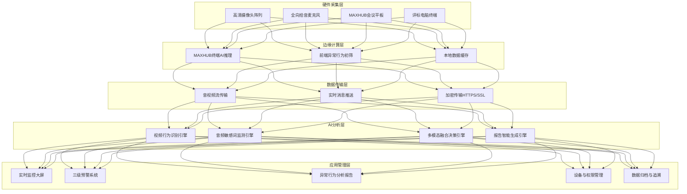

# 系统架构设计

> 本文档详细描述多模态AI远程异地评标专家异常行为识别系统的五层架构设计、硬件方案、数据流设计和技术选型。

---

## 一、架构总览

系统采用**五层架构设计**，自下而上分为：硬件采集层、边缘计算层、数据传输层、AI分析层、应用管理层。



---

## 二、硬件采集层

### 2.1 双场景硬件方案

系统支持政府采购评审的两大核心场景：

#### 场景一：隔断型评标工位

| 硬件设备 | 规格要求 | 数量 | 用途 |
|---------|---------|------|------|
| 评标电脑 | 内置远程评标软件，支持Windows/国产系统 | 每工位1台 | 专家评审操作终端 |
| 高清摄像头 | 1080P/4K，广角，支持低光照 | 每工位1个 | 采集专家视频画面 |
| 全向拾音麦克风 | 360°拾音，降噪，回声消除 | 每工位1个 | 采集专家音频 |
| 耳机/耳麦 | 头戴式，降噪 | 每工位1个 | 专家听音，避免互相干扰 |

**核心功能：**
- 专家一键入会、实时音视频交互
- 评标辅流资料同步推送
- 独立评标行为监控（每位专家独立画面和音频）

#### 场景二：专用型评标场所

| 硬件设备 | 规格要求 | 数量 | 用途 |
|---------|---------|------|------|
| MAXHUB会议平板 | 65-86英寸，4K，触控，内置摄像头和麦克风阵列 | 1台 | 主显示和交互终端 |
| 高清摄像头阵列 | 多角度，全景+特写，支持云台 | 2-4个 | 采集全场和专家特写 |
| 全向拾音麦克风阵列 | 多麦阵列，波束成形，声纹定位 | 1-2套 | 采集全场音频，定位发言人 |
| 无线传屏器 | 支持HDMI/Type-C，一键投屏 | 2-4个 | 专家电脑内容投屏 |

**核心功能：**
- 多专家本地投屏、双向音视频互通
- 标书协同批注与共享
- 集体讨论行为监控（全场+个体）

### 2.2 MAXHUB硬件生态优势

本项目联合**视源股份（MAXHUB）**研发，深度适配MAXHUB硬件生态：

- **MAXHUB会议平板**：国内IFPD会议市场出货量市占率29.6%，行业领先
- **X Board会议平板**：经微软Teams Rooms认证
- **BM45全向拾音麦克风**：专业级音频采集
- **P30摄像头**：高清视频采集
- **低延迟传输**：音视频交互延迟≤100ms
- **国产适配**：兼容鸿蒙/麒麟等自主操作系统

---

## 三、边缘计算层

### 3.1 边缘AI推理架构

系统采用**边缘计算+集中运算融合**架构：

**前端边缘节点（MAXHUB终端/评标电脑）：**
- 集成轻量化AI模型（YOLOv8n + Whisper-small）
- 本地实时初筛简单异常行为（操作手机、离席、基础敏感词）
- 只传输异常片段和特征数据，降低带宽压力
- 网络中断时本地缓存，恢复后补传

**后端集中运算（服务器/云端）：**
- 部署完整模型（YOLOv8x + SlowFast + Whisper-large-v3）
- 进行多模态融合分析、语义理解、复杂行为识别
- 生成异常行为分析报告
- 模型训练和更新

### 3.2 边缘-云端协同策略

| 任务类型 | 执行位置 | 说明 |
|---------|---------|------|
| 人体/手机目标检测 | 边缘 | 轻量模型，实时性要求高 |
| 基础敏感词匹配 | 边缘 | 词库匹配，计算量小 |
| 时序行为识别 | 云端 | 复杂模型，需要更多算力 |
| 语义理解/消歧 | 云端 | 大语言模型，需要大量算力 |
| 多模态融合决策 | 云端 | 需要综合三路数据 |
| 报告生成 | 云端 | 非实时，可批量处理 |

---

## 四、数据传输层

### 4.1 音视频流传输

- **协议**：支持国际通用音视频编解码协议（H.264/H.265、OPUS/AAC）
- **BFCP双流协议**：支持评标屏幕共享（Word、PPT、Excel、PDF、图片、视频、音频）
- **低延迟**：端到端延迟≤100ms（MAXHUB终端）
- **抗丢包**：支持30%网络丢包下的流畅传输
- **多并发**：支持≥10组同步评审，各场景画面和声音互不影响

### 4.2 实时消息推送

- **WebSocket**：预警信息、系统通知的实时推送
- **MQTT**：设备状态、传感器数据的轻量级传输
- **消息队列**：Kafka/RabbitMQ，用于异常事件的异步处理

### 4.3 数据安全传输

- **加密传输**：HTTPS/SSL/TLS 1.3
- **音视频加密**：SRTP加密传输
- **身份认证**：双向证书认证
- **完整性校验**：数据签名，防止篡改

---

## 五、AI分析层

### 5.1 视频行为识别引擎

**技术栈：**
- 目标检测：YOLOv8（人体、手机、人脸、手部）
- 时序行为识别：SlowFast网络（操作手机、起身离席、交头接耳）
- 人脸关键点：MediaPipe（68个关键点，低头、遮挡、视线）
- 姿态估计：OpenPose/MediaPipe Pose（人体姿态、动作）
- 多目标跟踪：DeepSORT（跨帧关联同一专家）

**检测的异常行为：**
- 操作手机（手机检测+手部交互+低头姿态）
- 起身离席（座位区域人体检测+持续时间）
- 交头接耳（多人距离+朝向+嘴部运动+麦克风状态）
- 肢体遮挡面部（手部位置+人脸关键点）
- 长时间静止/走神（姿态+头部运动+视线）

详见：[abnormal-behavior-taxonomy.md](abnormal-behavior-taxonomy.md)

### 5.2 音频敏感词监测引擎

**技术栈：**
- 语音转文字（ASR）：Whisper-large-v3中文模型
- 违禁词匹配：AC自动机多模式匹配
- 声纹分离：说话人分离（Speaker Diarization）
- 语义理解：大语言模型辅助上下文消歧

**四大类违禁词库：**
1. 核心违禁词与高风险表述（14个）
2. 敏感信息泄露类（15个）
3. 倾向性言论类（14个）
4. 非正常评价类（12个）
+ 高风险句式正则匹配（10+条）

详见：[sensitive-word-library.md](sensitive-word-library.md)

### 5.3 多模态融合决策引擎

**融合策略：**
- 时间戳对齐：三路数据按精确时间戳对齐
- 置信度加权：根据异常类型动态调整各通道权重
- 交叉验证：单一通道检测需其他通道辅助验证
- 综合判定：输出异常类型、置信度、证据包

**融合决策公式：**
```
final_score = w_video × video_score + w_audio × audio_score + w_log × log_score

权重动态调整：
- 操作手机：w_video=0.7, w_audio=0.1, w_log=0.2
- 不当言论：w_video=0.1, w_audio=0.8, w_log=0.1
- 交头接耳：w_video=0.5, w_audio=0.4, w_log=0.1
```

详见：[multimodal-fusion.md](multimodal-fusion.md)

### 5.4 报告智能生成引擎

**功能：**
- 评审结束后自动生成疑似异常行为分析报告
- 汇总视频行为记录、音频敏感词记录、系统日志
- 按异常类型分类整理，去重合并
- 识别活跃视频时段（有效工作时段）
- 统计分析（异常数量、分类统计、预警处置统计）
- 生成结构化报告（PDF/Word）

**报告结构：**
1. 项目基本信息
2. 疑似异常行为分析（5大类表格）
3. 活跃视频时段记录
4. 综合结论（统计+处理建议）

详见：[analysis-report-template.md](analysis-report-template.md)

---

## 六、应用管理层

### 6.1 实时监控大屏

- 多画面监控（支持1/4/9/16/25分屏）
- 画面轮询（可设置轮询时间）
- 异常行为实时标注（画面边框变色+标签）
- 预警信息实时弹窗
- 评审进度和状态展示

### 6.2 三级预警系统

- 🟡 黄色预警：音频提示+侧边浮窗5秒+记录归档
- 🟠 橙色警示：音频警告+中央弹窗+片段回放+通知主持人
- 🔴 红色警报：全屏警告+建议暂停+证据包生成+通知监管

详见：[sensitive-word-library.md](sensitive-word-library.md)

### 6.3 异常行为分析报告

- 自动生成结构化报告
- 支持人工确认和补充
- 支持导出PDF/Word
- 支持打印（含水印和防伪标识）
- 报告访问全程留痕

### 6.4 设备与权限管理

- 账号管理（超级管理员、部门管理员、主持人、专家等角色）
- 权限管理（分级分权，角色权限配置）
- 设备管理（终端注册、状态监控、固件升级）
- 通讯录管理（部门、人员、专家库）

### 6.5 数据归档与追溯

- 三级存储（热/温/冷数据）
- 音视频资料全程归档
- 异常片段结构化归档（标签化处理）
- 一键定位、调阅、关联取证
- 存储周期≥10年（符合GB/T 18894）

---

## 七、技术性能指标

| 指标 | 目标值 | 说明 |
|------|--------|------|
| 异常行为识别准确率 | ≥95% | 多模态融合后综合准确率 |
| 视频行为检测延迟 | ≤200ms | 从行为发生到预警触发 |
| 音频转写延迟 | ≤1秒 | 实时语音转文字 |
| 音视频交互延迟 | ≤100ms | MAXHUB终端低延迟传输 |
| 违禁词检测准确率 | ≥98% | 四大类违禁词库匹配 |
| 误报率 | ≤5% | 多模态融合+语义消歧后 |
| 并发评审支持 | ≥10组 | 同时进行的远程评标业务数 |
| 系统可用性 | ≥99.9% | 7×24小时稳定运行 |
| 等保级别 | 二级及以上 | 网络安全等级保护 |
| 数据存储周期 | ≥10年 | 符合电子档案管理规范 |

---

## 八、相关资源

- 多模态融合方案：[multimodal-fusion.md](multimodal-fusion.md)
- Agent工作流：[agent-workflow.md](agent-workflow.md)
- 边缘部署方案：[edge-deployment.md](edge-deployment.md)
- 异常行为分类体系：[abnormal-behavior-taxonomy.md](abnormal-behavior-taxonomy.md)
- 违禁词库与三级预警：[sensitive-word-library.md](sensitive-word-library.md)
- 分析报告模板：[analysis-report-template.md](analysis-report-template.md)
- 合作创新采购模式：[cooperative-innovation-procurement.md](cooperative-innovation-procurement.md)
- 视频行为识别代码：[code-snippets/behavior_detection.py](../code-snippets/behavior_detection.py)
- 敏感词监测代码：[code-snippets/sensitive_word_monitor.py](../code-snippets/sensitive_word_monitor.py)
- 多模态融合代码：[code-snippets/multimodal_fusion.py](../code-snippets/multimodal_fusion.py)
- Agent工作流代码：[code-snippets/agent_workflow.py](../code-snippets/agent_workflow.py)
